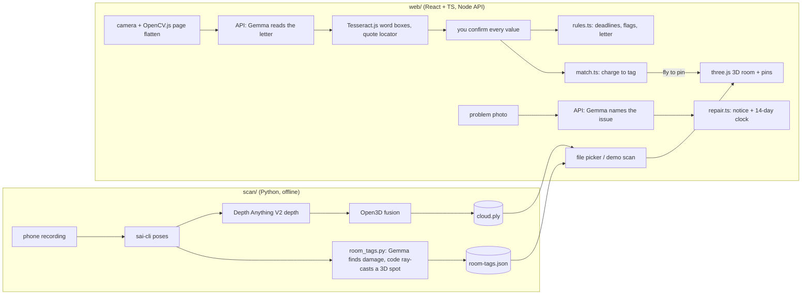

# Home Lens

**One camera for your home and your papers.** Built at GDG Build with AI × Hacktoberfest 2026 (Virginia Tech, theme: AI for Housing, Gemma 4 track).

Three moments in a renter's year, one app:

| | What you do | What runs |
|---|---|---|
| **Move in** | Load your room scan: a 3D map with a pin on each damage tag found by Gemma. Confirm or remove every tag. | `scan/` (VSLAM pipeline, Python) makes the scan; the web app displays it |
| **Report a problem** | Photo of what is wrong. Gemma names it, you fix the words, code writes a repair notice and the 14-day clock (Va. Code § 55.1-1244.1). | `web/` |
| **Move out** | Point the camera at the landlord's deduction letter. Gemma reads it, every value is highlighted on the paper, charges are matched to your move-in tags, and the 3D view **flies to the pin** of each matched tag. You get the 45-day deadline, a flag per charge, a letter and an evidence sheet. | `web/` |

**Information, not legal advice.**

**Demo video (2 min):** VIDEO_LINK

## Model

**Gemma 4, `gemma-4-26b-a4b-it`**, through the Gemini API (Gemma 4 track). Open-weight local mode: `gemma4:e4b` via Ollama (`MODEL_PROVIDER=ollama`).
Gemma terms of use: https://ai.google.dev/gemma/terms

## Run the web app

```bash
cd web && npm install
cp .env.example .env            # set GEMINI_API_KEY (https://aistudio.google.com/apikey); never commit it
npm run dev                     # API :8710, app :5180
# other ports: PORT=8720 WEB_PORT=5190 npm run dev
```

Open the app and press **Use demo scan** (Move in) to see the whole thing without any scan files. Other commands in `web/`: `npm test`, `npm run typecheck`, `npm run shots` (headless Chrome at 390 and 1440 px into `web/shots/`), `npm run samples` (regenerate sample letters), `node scripts/make-demo.mjs` (regenerate the demo scan). `MODEL_PROVIDER=mock` runs without a model. The camera needs HTTPS or `localhost`.

| Variable | Default | |
|---|---|---|
| `MODEL_PROVIDER` | `gemini` | `gemini`, `ollama` or `mock` |
| `GEMINI_MODEL` | `gemma-4-26b-a4b-it` | |
| `OLLAMA_URL` / `OLLAMA_MODEL` | `http://localhost:11435` / `gemma4:e4b` | local mode, nothing leaves the machine |
| `PORT` / `WEB_PORT` | `8710` / `5180` | API and dev server |

## Run the room scan pipeline

See [`scan/README.md`](scan/README.md) for setup (Python 3.12, `sai-cli`, a phone recording from the Spectacular Rec app). In short:

```bash
python scan/pipeline.py poses data/room1     # recording -> keyframes + poses
python scan/pipeline.py depth data/room1     # depth per keyframe (GPU helps)
python scan/pipeline.py fuse  data/room1     # -> cloud.ply, mesh.ply
python scan/room_tags.py tag data/room1 --room "living room"   # Gemma damage tags -> room-tags.json
python scan/room_tags.py review data/room1   # you confirm or remove each tag
python scan/compare.py data/room1 --photo moveout.jpg --box x0 y0 x1 y1   # move-out photo -> nearby tags
```

### Loading a real scan into the app (no code changes)

On **Move in** (or the scan step of Move out), press **Choose scan files** and pick `room-tags.json` and `cloud.ply` from `data/<scan>/`, plus the photos (or press **Choose a scan folder** and pick `data/<scan>/`). The viewer uses PLYLoader, so a `mesh.ply` works too (drawn as a surface). Tags are placed at their `position` [m]; a tag whose `position` is `null` (its box missed the map) appears in the list with no pin. The cloud is treated as **z up** (the SLAM world) and the view has a "Room upside down? Flip it" link. Clouds over 1.2 million points are thinned for the browser. Photo paths in `room-tags.json` are matched against the picked files by path or file name; data URLs from `room_tags.py inline` work as they are. The static scan-bundle `.json` format of `web-static/` also loads. The demo uses the same reader, so what works for the demo works for a real scan. Demo files: `web/public/samples/demo/` (a synthetic studio, not a real room).

## Architecture



## What is AI and what is code

| Step | Who |
|---|---|
| Read the deduction letter into fields, each with the exact printed line | Gemma 4 (`web/server/model.ts`) |
| Name visible damage in room frames, draw a box | Gemma 4 (`scan/room_tags.py`) |
| Name the problem in a "Report a problem" photo | Gemma 4 (you edit it) |
| Page detection and flattening, word boxes, highlight placement | OpenCV.js, Tesseract.js, `locate.ts` |
| Camera poses, depth scale, 3D fusion, 3D position of a tag | `sai-cli`, Depth Anything V2, Open3D, plain code (the model never produces coordinates) |
| Deadlines (45 days, 14 days), charge flags, the letter and the repair notice | Plain, tested TypeScript |
| Charge to tag matching | Plain code, always shown as "possible match, confirm" |
| Is it damage? Is it normal wear and tear? Who pays? | You and the law, never this tool |

Gemma may miss damage or misname a problem (in our test run it called a bent blind "Broken window pane"); every value is editable and nothing is complete by default.

## Privacy

- The photo goes to the Gemini API to be read. **The Gemini API free tier may use submitted data to improve Google products, so demo with the sample documents only.** For real papers, run locally with `MODEL_PROVIDER=ollama` (`gemma4:e4b`).
- Scan files, 3D clouds, OCR, page detection and matching stay in the browser. No accounts, nothing stored by this app, the API keeps no request bodies.
- A home scan is more identifying than a photo. `data/` (raw recordings) is gitignored. The one real scan in this repo, `web/public/samples/house/` (a point cloud and one tagged photo of a team member's living room), is published with that team member's permission. The move-out demo room is generated.

## Status and limits

Works end to end: demo scan, 3D view, confirm/remove tags, fly-to-pin from a matched charge, letter reading with the real model, deadline, letter, evidence sheet, repair notice. Move in loads a real scan: Dhruv's living room (236,597 points), processed with `scan/pipeline.py` and tagged by Gemma (`scan/room_tags.py`): one tag, a hole in the sofa seat. The move-out samples use a synthetic demo room, because the sample letter's charges (carpet, wall, counter) are matched against its tags. The scan side was tested on one room and its scale was never checked against a tape measure; see `scan/README.md`. The statute cites are from the team brief and `CLAUDE.md`; the repair statute does not name leaks or mold, so the notice says "may fall under". The 5-day move-in objection (§ 55.1-1214) from `web-static/rules.js` is not ported.

## Repository

```
web/            React + TS app and Node API (the app shell)
web-static/     Dhruv's earlier static app (vanilla JS), kept untouched for reference and credit
scan/           VSLAM room scan, Gemma room tags, move-out photo compare (Python)
shared/         room-tags.schema.json, the hand-off from scan to app
src/            an earlier measurement pipeline (Python)
```

## Credits

- **Dhruv: the room scan** (`scan/`, `src/`, and the static app and 3D viewer in `web-static/`, ported to `web/src/lib/viewer3d.ts`).
- **The document side** (`web/`): camera, page flattening, reading overlay, Virginia deposit rules, matcher, letter, evidence sheet, and this integration.

## Third-party notices

| Piece | Licence | Note |
|---|---|---|
| **Spectacular AI SDK (`sai-cli`)** | **Proprietary, "free for non-commercial use"** | **Not open source.** Installed separately, never vendored. The scan pipeline's pose step depends on it. |
| Depth Anything V2 Metric Indoor **Small** | Apache-2.0 | Trained on Hypersim (CC BY-SA 3.0). Base, Large and Giant are CC-BY-NC-4.0 and are not used. |
| Open3D | MIT | |
| three.js (`three@0.180.0`) | MIT | 3D viewer and PLYLoader |
| OpenCV.js (`@techstark/opencv-js`) | Apache-2.0 | page detection |
| Tesseract.js and English data | Apache-2.0 | OCR word boxes |
| Gemma 4 | [Gemma terms of use](https://ai.google.dev/gemma/terms) | |
| React, Vite | MIT | |
| Barlow Condensed, Public Sans | SIL OFL 1.1 | via Fontsource |

This code is MIT (see `LICENSE`).

Information, not legal advice.
